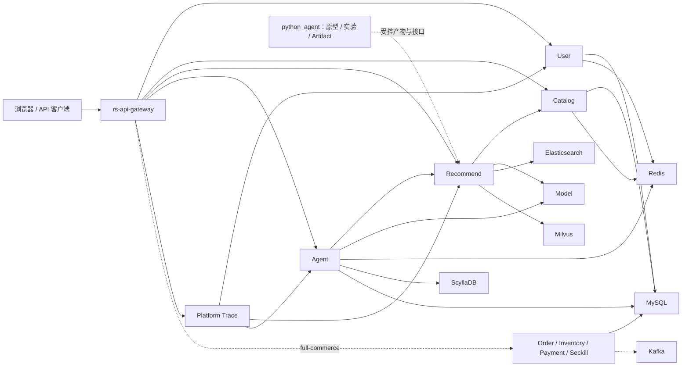
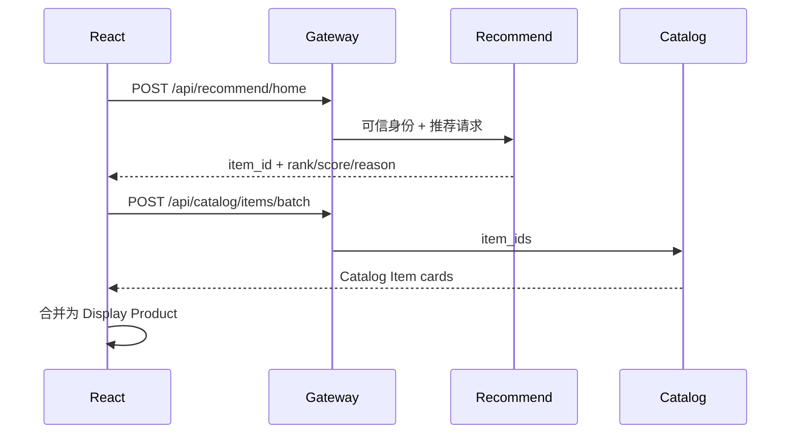
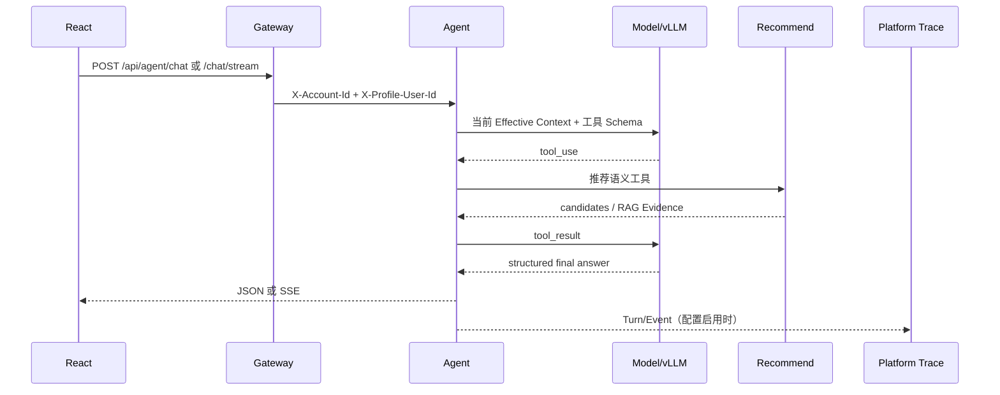
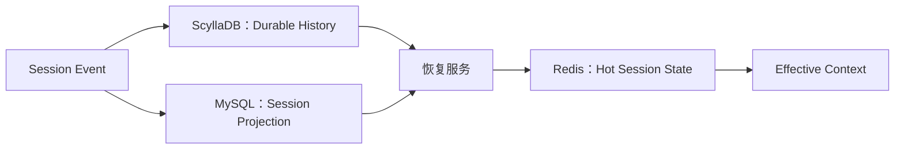

# 系统架构

2026-09-05：推荐模型调用统一经 Java Model HTTP 适配器，分别配置 embedding 和重排后端；BGE 运行时可选加载本地 CrossEncoder。Mock 默认关闭，未配置能力明确不可用。详见 [服务修复记录](../superpowers/plans/2026-09-05-service-reliability-repairs.md)。

## 系统上下文

系统分为四个层次：

1. 入口与体验：Gateway、Java React 前端、Python demo 前端。
2. 产品服务：User、Catalog、Recommend、Agent、Model、Platform Trace，以及可选交易服务。
3. 数据与模型基础设施：MySQL、Redis、ScyllaDB、Elasticsearch、Milvus、MinIO、Kafka、vLLM/BGE。
4. Python 研发底座：数据加工、召回排序、Serving、仿真、训练、评估和 Artifact 治理。

## Java 模块边界

模块清单以 [java_agent/pom.xml](../../java_agent/pom.xml) 为准。

| 模块 | 责任 | 不应承担 |
| --- | --- | --- |
| `rs-api-gateway` | 统一外部入口、路由、认证身份注入、请求 ID、限流和 CORS | 业务规则、商品拼装、推荐算法 |
| `rs-service-user` | Account、Profile User 绑定、认证会话和用户 Session | 推荐决策、Agent 会话历史 |
| `rs-service-catalog` | Catalog Item、类目、虚拟店铺、商品批量补全和缓存 | 候选生成、排序理由 |
| `rs-service-recommend` | 召回、粗排、精排、重排、反馈、推荐 RAG 和相关 trace | Agent 循环、认证身份、商品事实所有权 |
| `rs-service-agent` | Session/Turn、模型循环、工具执行、SSE、会话恢复和 Agent trace | 直接依赖底层检索存储、执行不可逆交易动作 |
| `rs-service-model` | 模型注册、健康、chat/stream、embedding、ranking/inference 适配 | 推荐业务编排、用户状态 |
| `rs-service-platform-trace` | 聚合 Account、Recommend、Agent 的观察视图 | 成为业务事实来源或修改业务状态 |
| `rs-service-order` | 创建、取消和更新订单状态 | 库存事实、支付回调验证 |
| `rs-service-inventory` | 库存可用性、锁定、确认扣减和释放 | 订单生命周期、支付 |
| `rs-service-payment` | 预支付、支付回调和订单支付通知 | 库存扣减、推荐反馈 |
| `rs-service-seckill` | 秒杀提交、Redis 控制和 Kafka 投递 | 同步创建完整订单 |
| `rs-common` | Maven 共享模块位置 | 当前无业务源代码，不应被当成跨服务业务模型仓库 |

Controller 采用四类边界：

- `controller/app`：面向应用客户端的 `/api/**`。
- `controller/internal`：服务间 `/internal/**`。
- `controller/platform`：平台观察与控制 `/api/platform/**`。
- `controller/agent`：只供 Agent 工具调用的 `/agent/**`。

详细路由见 [接口与数据契约](contracts.md)。

## Python 模块边界

| 模块 | 责任 | 成熟度 |
| --- | --- | --- |
| `rs_core/data` | 数据契约、Artifact、数据管道、数据客户端和 worker | 稳定边界 |
| `rs_core/online` | 在线召回、排序、候选存储、向量存储和 runtime | 稳定/试运行边界 |
| `rs_core/agent` | Agent contracts、runtime、tools、RAG、memory 和反馈 | 稳定/试运行边界 |
| `rs_core/offline` | 训练、评估、实验接口和 offline worker | 稳定薄抽象，具体重任务仍受控 |
| `rs_core/serving` | FastAPI、应用服务、domain、infrastructure 和组合入口 | demo/试运行 Serving |
| `rs_core/display` | 推荐结果到公开展示 Schema 的映射 | 对外契约边界 |
| `rs_core/workflow` | 已通过治理、可复用的稳定流程 | 不允许硬编码 phase/batch/临时输出路径 |
| `rs_lab` | 实验脚本、诊断 batch、方法验证和阶段 gate | 实验区，不自动晋级 |
| `scripts` | CLI 薄入口，按 data/artifacts/serving/evaluation/training 等分类 | 只做参数解析和流程触发 |

Python 的详细迁移与兼容边界由 [PROJECT_STRUCTURE](../../python_agent/dic/PROJECT_STRUCTURE.md) 和 [治理指南](../../python_agent/dic/guides/CODEBASE_GOVERNANCE_GUIDE.md) 维护。

## 关键调用流程

### 首页推荐和商品展示

Recommend 不拥有商品标题、图片和价格；Catalog 不决定推荐排序。首页和 Agent 页面应复用同一展示映射。

### Agent 对话与工具循环

同一 Session 的 Turn 由唯一 Session Execution Lane 串行执行。模型流使用虚拟线程，并分别限制活跃循环、模型流和工具调用并发。

### 会话恢复

恢复正确性不得依赖 Redis 数据仍然存在。详细数据权威关系见 [数据流与事实来源](data-flow.md)。

### 可选交易流程

`full-commerce` profile 才开放交易路由：普通订单同步调用 Inventory 完成锁定；Payment 回调通知 Order；秒杀入口通过 Kafka 主题 `seckill-order-create` 交给 Order 消费。任何把交易动作接入 Agent 的工作都必须先满足 Replay-safe Tool ADR 的扩展条件。

## 部署拓扑

Java 远程部署分两套 Compose：

- [infra compose](../../java_agent/deploy/remote/infra/docker-compose.yml)：Nacos、MySQL、Redis、Elasticsearch、MinIO、ScyllaDB、Milvus；Kafka 只在 `full-commerce` 启用。
- [app compose](../../java_agent/deploy/remote/app/docker-compose.yml)：数据库迁移任务、Java 服务和 Gateway。

应用启动前必须完成 MySQL 与 ScyllaDB 迁移；服务 readiness 通过 Actuator 检查。远程端口绑定到 `127.0.0.1`，本地通过 SSH tunnel 访问；不要将数据库直接暴露到公网。

Python 提供独立的 [deploy](../../python_agent/deploy/README.md)，可以按 `frontend`、`online`、`agent`、`gateway`、`worker`、`infra` profile 组合。它是 Python 原型和验证环境，不替代 Java 默认产品部署。

## 架构变更检查点

新增模块或改变调用方向前，至少回答：

1. 新能力的业务所有者是谁，是否已经有服务承担？
2. 使用 `/api`、`/internal`、`/agent` 还是 `/api/platform`，原因是什么？
3. 新数据是权威事实、投影、缓存、Artifact 还是临时诊断？
4. 是否改变现有 ADR、推荐 route gate 或公开展示 allowlist？
5. Java 主线与 Python 原型之间是 API、Artifact 还是仅研究关系？
6. 最小 contract test、integration test 和 smoke 分别是什么？
