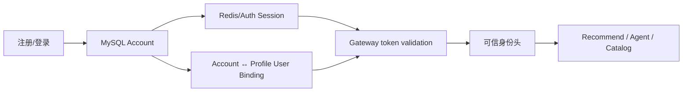
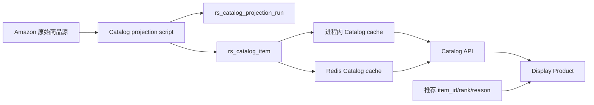
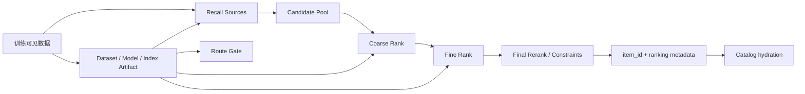
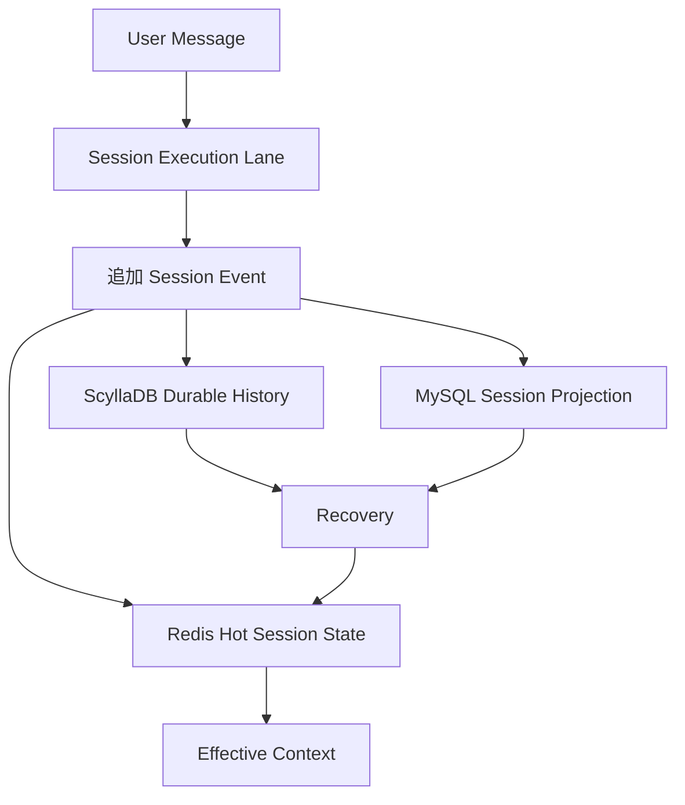
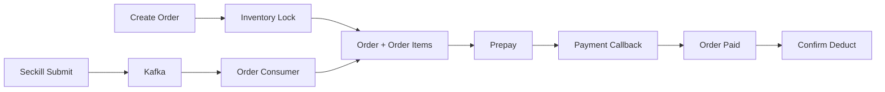

# 数据流与事实来源

2026-09-05：反馈快照使用 rs:pref:v2:*，携带商品级版本与删除标记，通过 Redis Lua 比较更新；MySQL 重建按画像和商品游标分批推进。Agent 历史和归属从持久记录恢复。切换期间必须核验历史反馈、撤销和重建完成状态，见 [修复记录](../superpowers/plans/2026-09-05-service-reliability-repairs.md)。

## 数据分类

每份数据在设计和代码评审中必须归入以下一种角色：

| 角色 | 定义 | 失败后的处理 |
| --- | --- | --- |
| 权威事实 | 决定业务实际发生了什么的唯一记录 | 恢复并保护，不能从缓存反向覆盖 |
| 投影 | 从权威事实派生、面向查询的视图 | 可修复或重建，需记录进度点 |
| 缓存/热状态 | 为性能和活跃执行保存的可重建状态 | 可失效，不作为最终正确性前提 |
| Artifact | 数据处理、索引、训练或评估产生的版本化资产 | 通过 manifest、hash、范围和构建命令复现 |
| Trace/诊断 | 观察、审计和排障信息 | 不能自动成为业务事实或 promotion 依据 |
| 配置/Schema | 约束运行方式和数据形状的版本化输入 | 变更必须评审、测试和迁移 |

禁止使用“数据库里有一份”来代替数据角色说明。

## 存储责任矩阵

| 组件 | 主要数据 | 角色 | 权威入口 |
| --- | --- | --- | --- |
| MySQL | Account、Profile User 绑定、认证会话、用户 Session | 业务事实/管理记录 | `rs_service_user_schema.sql` |
| MySQL | Catalog Item 和 Catalog projection run | Catalog 商品事实与投影进度 | `rs_service_catalog_schema.sql` |
| MySQL | Order、Order Item、Stock、Payment、消费幂等日志 | `full-commerce` 业务事实 | `rs_service_trade_schema.sql` |
| MySQL | Agent Session/Turn/Tool/Checkpoint/Memory index | 会话管理投影和可修复定位 | `rs_service_agent_mysql_projection_schema.sql`、[ADR-0001](../adr/0001-session-history-and-checkpoint-authority.md) |
| MySQL | Recommendation Delivery、Recommendation Feedback Event、Preference Version | `planned`：推荐交付归因与反馈权威事实 | [ADR-0017](../adr/0017-feedback-event-authority-and-online-preference-projection.md)、[在线反馈闭环设计](../superpowers/specs/2026-08-24-online-feedback-closed-loop-design.md) |
| ScyllaDB | Session Event、Transcript Entry、Checkpoint、Memory Item | Durable Session History 与长期记忆内容的追加事实 | `rs_service_agent_scylla_session_schema.cql`、[ADR-0001](../adr/0001-session-history-and-checkpoint-authority.md) |
| Redis | 认证 token/session、Agent Hot Session State、Catalog cache、秒杀热状态；`planned` Session/Profile Preference | 可重建热状态/缓存 | 各服务配置与实现、[ADR-0017](../adr/0017-feedback-event-authority-and-online-preference-projection.md) |
| Elasticsearch | 商品 BM25、推荐/RAG 文本检索索引 | 可重建索引 Artifact | Recommend 配置和索引构建流程 |
| Milvus | 商品语义向量、RAG chunk 向量和两塔 item vectors | 可重建向量索引 Artifact | collection 配置、manifest 和构建脚本 |
| MinIO | 数据、模型、索引等大体积 Artifact | 对象存储，不是路由晋级本身 | Artifact manifest 与对象路径 |
| Kafka | 秒杀下单消息 | 传输日志；业务结果仍由 Order/MySQL 确认 | topic `seckill-order-create` 与消费者幂等表 |
| Nacos | 服务发现和运行配置 | 控制面配置，不存业务事实 | Java application/部署配置 |

## Java Schema 清单

Java 的版本化数据库对象位于 [java_agent/sql](../../java_agent/sql/)：

### User

- `rs_auth_account`
- `rs_account_profile_binding`
- `rs_auth_session`
- `rs_user_session`
- `rs_schema_version`

### Catalog

- `rs_catalog_item`
- `rs_catalog_projection_run`
- `rs_schema_version`

### Agent MySQL projection

- `agent_sessions`
- `agent_turns`
- `agent_tool_calls`
- `agent_checkpoints`
- `agent_memory_indexes`
- `agent_schema_version`

### Agent ScyllaDB

- `rs_agent.agent_transcript_entries_by_session`
- `rs_agent.agent_transcript_checkpoints_by_session`
- `rs_agent.agent_session_events_by_session`
- `rs_agent.agent_session_snapshots_by_session`
- `rs_agent.agent_memory_items_by_user`
- `rs_agent.agent_schema_version`

### Trade

- `orders`、`order_items`
- `sku_stock`、`stock_logs`
- `payment_orders`、`payment_callbacks`
- `consumer_message_log`
- `rs_schema_version`

表名只是索引；字段、约束和版本以 SQL/CQL 文件为准。

## 关键数据流

### Account 到个性化身份

客户端请求体中的画像用户不是可信身份来源。Gateway 根据 token validation 结果注入 `X-Account-Id`、`X-Profile-User-Id` 和角色。

### 原始商品到展示商品

远程 bootstrap 使用 `project_catalog_to_mysql.py` 将 `amazon_items_base` 投影为标准 Catalog。每批 upsert 与 cursor 在同一事务提交；只有最新 run 为 `COMPLETED` 且 source/projected count 一致后，才能进行 Catalog 验收。

Catalog cache key 使用版本前缀，序列化或字段映射改变时必须升级前缀。Redis 失败时允许回源 MySQL；MySQL 失败必须明确失败，不能生成假商品。

### 推荐 Pipeline 与 Artifact

Artifact 至少应记录：Schema/version、数据范围、禁止的数据范围、行数、hash、构建命令、环境、seed、模型/tokenizer/checkpoint 标识、输出路径和 gate 结果。Artifact 存在或可读取，不等于获得主路使用授权。

当前 Python 路由和 Artifact 引用以 [Current Route Registry](../../python_agent/configs/governance/current_route_registry.yaml) 为入口。`outputs/` 中未被 registry、ADR 或正式报告引用的内容只视为临时运行产物。

### 已接受但待实现的在线反馈数据流

ADR-0017 已决定 MySQL 为推荐反馈事实和跨实例幂等的权威来源，Redis 只保存可重建在线偏好投影。该链路当前仍为 `planned`；现有 `InMemoryRecommendFeedbackService` 不能作为已完成能力或持久化事实来源。实现范围、失败语义和验收门禁见 [在线反馈闭环设计](../superpowers/specs/2026-08-24-online-feedback-closed-loop-design.md)。

### Agent 会话和恢复

正确性规则：

- ScyllaDB 追加记录是会话事实来源。
- MySQL 用于 Session 列表、状态、最新 Checkpoint 定位和修复查询，不是完整会话事实副本。
- Redis 丢失后必须可从 ScyllaDB 和 MySQL 定位信息恢复。
- Context Checkpoint 只保存压缩语义和边界元数据，不保存运行时提示词、工具 Schema 或动态配置。
- Long-term Memory 以 `user_id`/Profile User 范围跨 Session；不能写入 Session History 冒充会话事件。

### full-commerce 数据流

库存锁定、回调和消息消费必须使用业务幂等键和持久记录。Agent 第一版不得直接触发这些不可逆动作。

## 迁移和启动顺序

远程 Java app compose 在服务启动前执行：

1. MySQL readiness 检查。
2. 顺序应用 User、Catalog、Trade、Agent projection SQL。
3. 查询 `rs_schema_version`。
4. 等待 ScyllaDB 并应用 Agent CQL。
5. 启动 Java 服务；Agent 在持久化启用时校验 MySQL/Scylla Schema version。

Schema 变更必须保持幂等迁移、显式版本和可观察失败。不得依赖开发者手工修改远程数据库后再补 SQL。

## 数据安全与清理

- `.env.local`、部署 `.env`、token、密码和模型 API key 不进入知识库、日志或 Artifact manifest。
- `db/**`、`data/**` 和 `outputs/**` 可能包含本地/远程实验数据；清理前确认是否有仍被 registry 或报告引用的 Artifact。
- 公开展示 payload 不得包含内部 trace、诊断路径或原始导出位置。
- 远程数据库只绑定 `127.0.0.1`，通过 SSH tunnel 访问；不要开放公网端口。
- 删除或重建 Elasticsearch/Milvus/MinIO 数据前，必须先确认 collection/index/bucket 的生成来源和可复现 manifest。
