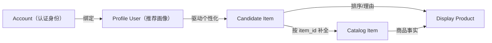

# 领域模型与核心不变量

## 领域语言入口

仓库根 [CONTEXT.md](../../CONTEXT.md) 是领域词汇的唯一权威来源。本知识库只解释词汇如何约束开发，不复制完整定义。

当前词汇分为三组：

- 会话与上下文：`Session`、`Turn`、`Session Event`、`Durable Session History`、`Hot Session State`、`Effective Context`、`Context Checkpoint`、`Long-term Memory`。
- 身份与商品：`Account`、`Profile User`、`Catalog Item`、`Display Product`。
- 推荐治理：`Candidate Item`、`Recall Source`、`Ranking Route`、`Route Gate`、`Read-only Shadow Evidence`、`Recommendation Artifact`、`RAG Evidence`。

新增 Issue、接口字段、类名、测试名和设计文档时，应优先使用这些术语。如果需要表达的新概念无法使用现有词汇准确描述，应先更新 `CONTEXT.md`，不要在各模块中自行发明同义词。

## 身份与商品关系

关键区别：

- `Account` 解决认证和权限；`Profile User` 解决推荐历史与个性化。客户端不能通过请求体覆盖 Gateway 注入的可信绑定。
- `Candidate Item` 可以只有 `item_id`、score、rank、reason 和内部证据；它不是商品事实来源。
- `Catalog Item` 是商品事实；`Display Product` 是展示组合，不得反向写回 Catalog 或推荐主路。

## Agent 与会话不变量

| 编号 | 不变量 | 依据 |
| --- | --- | --- |
| `INV-SESSION-001` | 同一 Session 内 Turn 串行，不同 Session 可以并行。 | [ADR-0006](../adr/0006-serialize-turns-within-each-session.md) |
| `INV-SESSION-002` | ScyllaDB 中追加的会话事实是 Durable Session History 的权威来源；MySQL 是管理投影，Redis 是可重建热状态。 | [ADR-0001](../adr/0001-session-history-and-checkpoint-authority.md) |
| `INV-SESSION-003` | Context Checkpoint 不固化系统提示词、工具 Schema 或动态配置；恢复时使用当前运行配置重新注入。 | [ADR-0002](../adr/0002-context-checkpoint-excludes-runtime-injection.md) |
| `INV-SESSION-004` | 上下文压缩只能发生在已持久化既有事件、无未完成工具调用、即将进行下一次模型调用的 Safe Compaction Boundary。 | [ADR-0003](../adr/0003-compaction-only-at-safe-model-call-boundaries.md) |
| `INV-SESSION-005` | 紧急裁剪必须按完整语义组执行并记录范围与原因；不得删除 Durable Session History。 | [ADR-0004](../adr/0004-auditable-lossy-context-truncation.md) |
| `INV-TOOL-001` | 第一版 Agent 只执行 Replay-safe Tool；订单、支付、外部消息等不可逆动作需要独立的确认、幂等和补偿设计。 | [ADR-0005](../adr/0005-first-release-tools-must-be-replay-safe.md) |
| `INV-RUNTIME-001` | 第一版部署只运行一个活跃 Agent 实例；未来水平扩展必须先解决 fencing token 和旧实例拒写。 | [ADR-0007](../adr/0007-first-release-uses-one-active-agent-instance.md) |
| `INV-RUNTIME-002` | 阻塞式模型流运行在 Java 虚拟线程上；并发限制承担供应商、内存和业务背压，不额外套固定平台线程池。 | [ADR-0008](../adr/0008-blocking-model-streams-run-on-virtual-threads.md) |

实现变更若与这些规则冲突，不应仅修改知识库，而应明确指出冲突并决定修改实现还是重开 ADR。

## 推荐与 RAG 不变量

| 编号 | 不变量 | 依据 |
| --- | --- | --- |
| `INV-REC-001` | 推荐 backbone 负责召回、排序与约束；Agent 负责语言理解、编排、解释和反馈响应，不直接替代全量召回排序。 | [Python 架构说明](../../python_agent/dic/architecture/ARCHITECTURE.md) |
| `INV-RAG-001` | 推荐场景的 RAG 归属 Recommend；Agent 只看到稳定的推荐语义工具，不感知 Elasticsearch、Milvus 或模型实现。 | [Agent RAG Boundary](../../java_agent/AGENT_RAG_BOUNDARY_DESIGN.md) |
| `INV-RAG-002` | RAG Evidence 只能在既有候选范围内提供 grounding，不得生成新商品或替代排序输入。 | [Python 架构说明](../../python_agent/dic/architecture/ARCHITECTURE.md) |
| `INV-CATALOG-001` | Recommend/Agent 产生 `item_id`、rank、score 和 reason；Catalog 补全商品事实；前端只负责组合展示。 | [真实商品展示设计](../superpowers/specs/2026-08-02-product-display-real-chain-design.md) |
| `INV-CATALOG-002` | 未知商品 ID 不生成伪造商品；价格、图片缺失时显示明确降级，不填充虚假值。 | [真实商品展示设计](../superpowers/specs/2026-08-02-product-display-real-chain-design.md) |
| `INV-FEEDBACK-001` | `exposure`、`like`、`dislike` 和 `why` 是不同事件；`why` 只查询解释，不改变偏好。 | [真实商品展示设计](../superpowers/specs/2026-08-02-product-display-real-chain-design.md) |

## 实验治理不变量

| 编号 | 不变量 | 依据 |
| --- | --- | --- |
| `INV-GOV-001` | `rs_core` 承载稳定边界，`rs_lab` 承载实验与诊断；实验代码不会因存在或测试通过而自动成为 core 能力。 | [rs_lab README](../../python_agent/rs_lab/README.md) |
| `INV-GOV-002` | 当前路由状态以 `configs/governance/current_route_registry.yaml` 为入口；实验晋级必须更新 registry 并通过对应 gate。 | [治理指南](../../python_agent/dic/guides/CODEBASE_GOVERNANCE_GUIDE.md) |
| `INV-GOV-003` | pool500 read-only shadow 不允许候选生成、排序输入替换、promotion 或 pool1000；`FULL_POOL500_READY` 只表示召回 Artifact readiness。 | [Current Route Registry](../../python_agent/configs/governance/current_route_registry.yaml) |
| `INV-GOV-004` | `DIAGNOSTIC_ONLY`、smoke、simulation、shadow 和 dirty Artifact 不能支持生产效果声明。 | [治理指南](../../python_agent/dic/guides/CODEBASE_GOVERNANCE_GUIDE.md) |
| `INV-GOV-005` | holdout、valid、test、oracle 或 eval label 不得作为候选生成输入；训练可见范围必须可审计。 | [治理指南](../../python_agent/dic/guides/CODEBASE_GOVERNANCE_GUIDE.md) |
| `INV-DISPLAY-001` | 公开展示采用 allowlist-first；`trace_ref`、`agent_runtime_trace`、`diagnostics_path`、`raw_export_trace_path`、`ranking_evidence_path` 等内部证据不得泄露。 | [Python PRD](../../python_agent/prd.json) 与 [Current Route Registry](../../python_agent/configs/governance/current_route_registry.yaml) |

## 冲突处理规则

1. 先确认冲突双方分别描述“实际实现”“已接受决策”“当前受治理路由”还是“规划/实验”。
2. 代码与测试只能证明当前行为，不能自动推翻 ADR；ADR 也不能证明代码已经实现。
3. 涉及路由晋级时，不以单次指标或 Artifact 存在作为结论，必须检查 registry 和 promotion gate。
4. 无法从现有证据判定时，将状态标为 `unknown` 并创建 GitHub Issue；不得选择对当前任务最方便的解释。
