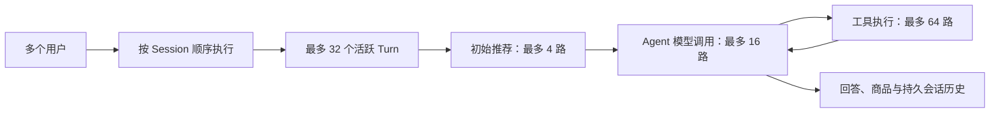

# Agent 多用户并发编排优化与验收（2026-10-11）

本轮保持 GPU 1 的模型进程、权重、量化及 vLLM 参数不变，调整 Java Agent 的请求调度。在 8 个真实账号、独立 Session 的常规 LLM 推荐测试中，原配置的 16 请求突发仅 8 条完整成功，另外 8 条返回 `AGENT_BUSY`；候选配置的 32 请求突发连续两批均 32 条完整成功。这个结果是已测试的突发容量，不是持续负载下的系统最大并发。

## 请求如何执行

不同 Session 的请求在虚拟线程上并行，同一 Session 通过 Session Execution Lane 顺序执行。不是每个用户启动一个服务进程，也不需要为每次推荐启动沙盒。

模型和推荐许可分别管理，模型调用之间释放模型许可；调用推荐能力的工具也使用同一个推荐容量限制。工具、模型及推荐许可在成功、异常退出后释放。模型容量等待期间的 Turn 取消会被及时观察，避免已经停止的 Turn 等完整个排队期限；工具等待沿用可中断虚拟线程 Future。

保留原有单活 Agent 约束。此次验证实例使用本次独立创建的 Session，没有把同一个 Session 分配给两个 Agent 实例；这不构成横向扩容验证。

## 瓶颈与改动

原配置允许 32 个活跃 Turn，却只允许 8 路 Agent 模型流，获取模型许可只等待 200ms。真实 16 请求复测中，8 条在约 475–507ms 返回 `AGENT_BUSY/503`。单纯延长等待能让请求完成，但未提升完成吞吐；增加模型入口容量后，下游排序又在 32 请求突发时出现降级。

因此使用 16 路模型调用、15 秒有界等待，并把推荐流水线限制为 4 路。这个限制用于保护下游，不改变召回、排序、LLM 合成、工具能力、商品目录或持久历史流程。Compose 原来没有向 Agent 转发执行容量环境变量，本轮补齐转发和可直接合并的 GPU 1 参数模板。

另外，在实际 AgentLoop 上先复现了模型排队期间取消不退出的问题，再补上中断检查。修复前 5 秒模型等待预算下，取消后 1 秒仍未退出；修复后该测试通过，并确认取消的 Turn 没有调用模型、许可仍能复用。

## 实测结果

| 编排配置 | 同时请求数 | 完整通过 | 合格完成吞吐（次/秒） |
| --- | ---: | ---: | ---: |
| 原配置：模型 8 路、等待 200ms | 8 | 8/8 | 0.989 |
| 原配置：模型 8 路、等待 200ms | 16 | 8/16 | 1.020 |
| 原配置复测 | 16 | 8/16 | 0.961 |
| 仅延长模型等待至 15 秒 | 16 | 16/16 | 0.945 |
| 模型 16 路，推荐未单独限制 | 16 | 16/16 | 1.382 |
| 模型 16 路，推荐未单独限制 | 32 | 30/32 | 0.716 |
| 模型 16 路，推荐 8 路 | 16 | 16/16 | 1.360 |
| 模型 16 路，推荐 8 路 | 32 | 31/32 | 1.147 |
| **候选：模型 16 路，推荐 4 路** | **16** | **16/16** | **1.508** |
| **候选：模型 16 路，推荐 4 路** | **32** | **32/32** | **1.452** |
| **候选复测** | **32** | **32/32** | **1.328** |

候选 16 请求批次的中位完成耗时为 9.718 秒，最大 10.588 秒。32 请求两批的中位耗时分别为 13.523、17.919 秒，最大分别为 22.003、24.070 秒。更多请求通过排队得到完整回答，排队本身会增加用户等待时间；本轮没有达到 300ms 完整推荐。

16 请求批次相对最初同级基线的合格完成吞吐约提高 48%。两批 32 请求吞吐为 1.33–1.45 次/秒。样本是单次批次及一次复测，不能将此比例当作持续负载收益或统计置信结论。中间配置中的排序降级请求全部计为失败，即使返回了 5 个商品和最终回答，也没有计入容量。

## 验证范围

- 基线、仅延长等待和未独立限制推荐的试验使用上一轮编排优化构建 `01ca31c3fd82f22822fa55d8faecc0064387000469ffebf9b9b600a7a2166805`；新增推荐限制及取消修复使用本轮构建 `4bc94fc…`。两者均由独立验收容器运行；共享 Agent 尚未部署这两轮构建。
- 使用当前 GPU 1 真实模型和真实推荐、DeepFM/BGE、目录、数据库持久历史；`DIRECT_RECOMMENDATION=false`，`LLM_SYNTHESIS=true`。简单输入为“推荐鼠标”，每条走 LLM 正文合成。
- 8 个真实账号在每批创建 8/16/32 个独立 Session；32 请求不等于 32 个不同账号。同 Session 串行由模块回归验证，本批负载不测试同 Session 竞争。
- 成功要求无错误事件、持久历史为 `FINAL_ANSWER`、正文非空、5 个真实且唯一的目录商品、DeepFM/BGE 实际排序阶段非空、无声明的排序降级；不只看 HTTP 200 或 SSE `done`。
- Session 创建在计时前，压测直达隔离 Agent 端口，以可信身份头携带账号及画像。不是从浏览器或网关认证入口开始计时。每条完成耗时包含 Agent 最终回答和目录读取；吞吐用合格完成数量除以整批墙钟时间，批次时间包含随后历史和追踪核验，预热不计入。
- 原有复杂推荐、工具、商品卡片及多轮“换一批”的 5 条真实功能样本通过；最终推荐 4 路参数再单独验收。不替代完整语义质量回归，也未测 32 条复杂推荐的并发或持续最大容量。
- 模型全局指标可能包含其他共享请求，不能从峰值直接推导每条 Turn 的模型调用数。各阶段模型 PID/启动命令相同，未改变共享模型或重启训练任务。

## 产物与落地状态

- `baseline.json`、`baseline-repeat.json`：原配置及错误码复测。
- `queue-only.json`、`wide16.json`：有界排队与模型入口扩容的独立试验。
- `final.json`：推荐 8 路的中间候选，**不是最终选定参数**。
- `guarded4.json`、`guarded4-repeat.json`：最终候选两批 32 请求验收。
- `functional.json`、`functional-rec4.json`：复杂推荐、多轮功能验收。
- `model-queue-cancellation-red.json`、`validation.json`：取消问题的失败证据、构建及回归汇总。
- `runtime-check.json`：共享服务健康、模型身份及本次容器和私有环境副本清理核验。
- `concurrency_probe.py`、`functional_probe.py`：可复跑的远程验收脚本，凭据从既有私有夹具读取，不写入公开结果。

Agent 新 JAR SHA-256：`4bc94fc6894a65fb933071ac91c2506c5964542c68d464f59155967c027c1c76`。模块回归 235 项，234 通过，1 项条件性模型测试跳过，无失败或错误。真实模型由本报告的独立实例验收补充。

候选参数在 [部署模板](../../../java_agent/deploy/remote/app/agent-gpu1-concurrency.env.example)，使用说明见 [部署文档](../../../java_agent/deploy/remote/app/README.md)。代码、JAR、部署变量与候选参数已备好；共享 Agent 服务尚未切换。本轮仅创建、清理本次独立验收容器和私有环境副本，保留共享业务服务、模型及训练进程。

后续按用户授权已切换共享 Agent；本报告保留切换前的独立验收状态。实际服务升级、复杂请求测试及后续共享依赖变更见 [部署后报告](../agent-live-complex-concurrency-20261011/README.md)。
