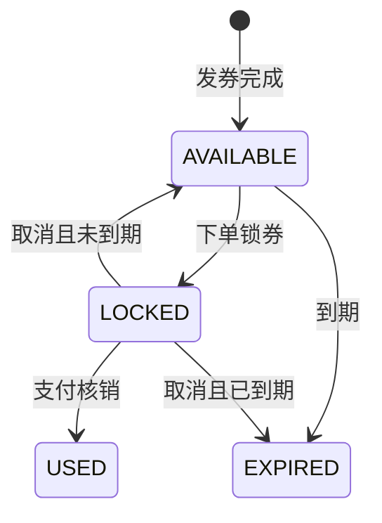

# 黑马点评的库存、优惠券与高并发设计如何用于 RS_agent

研究日期：2026-09-13。范围：公开课程资料、基础设施官方文档、当前工作区源码静态核查。本文是研究建议，不是已实施架构或压测报告；工作区有大量在途修改，结论以本次读取版本为准。

实施更新：用户确认后已开始落地，以下“当前代码”描述的是实施前快照。实际接口、状态机、验证范围和部署方式见 [交易第一版说明](D:/sinrotic_code/python_project/summer/RS_agent/docs/commerce-v1.md)；原 Redis 预扣脚本已由数据库权威受理与 Outbox 替代。

## 结论

适合借鉴。建议把项目扩展为“推荐与 Agent 导购 → 商品和优惠展示 → 限量领券 → 下单锁库存和锁券 → 支付核销 → 真实转化反馈”的闭环。高并发的主要落点是热点商品读取、限量领券和秒杀入口，交易正确性的主要落点是库存预留、券实例状态机、业务幂等和失败恢复。

现有 Java 工程已经有库存、订单、秒杀实现，不能按部分 README 中的“仅预留目录”判断现状。应先补齐现有链路的一致性与恢复能力，再加优惠券领域。继续使用已有 MySQL、Redis、Kafka；不因课程使用 Redis Streams 就替换现有业务消息系统。

## 1. 黑马点评可以参考到什么程度

黑马程序员的 Redis 课程以黑马点评为实战项目，官方课程目录包含优惠券秒杀、全局唯一 ID、防超卖、一人一单、分布式锁、Lua 和异步消息等主题。本次核查的是官方课程页面的搜索索引与目录，页面直接抓取出现 412，未完整观看视频，未确认官方公开源码仓库。不能把网上任何同名 GitHub 仓库视为官方生产方案。[官方课程](https://www.bilibili.com/video/BV1cr4y1671t/)、[优惠券秒杀章节](https://www.bilibili.com/video/BV1cr4y1671t?p=48)

适合学习的技术推进顺序是：数据库条件扣减保证数量下界，业务唯一性限制重复购买，Redis Lua 将入口校验与预扣合并，异步消费平滑数据库负载。课程中的优惠券秒杀也不等于完整的电商优惠系统；本项目仍需自行设计满减门槛、适用范围、领券资格、锁券、核销和退款政策。

另外核查了自称来自该课程的社区参考仓库：其 Lua 将库存校验、用户去重、预扣和 XADD 放在同一脚本中，订单服务使用消费者组并在处理后 ACK。这是“同库记录待处理意图”的具体代码例子；来源不是已确认的官方仓库，只能用于理解该版本实现，不能据此保证课程所有版本相同或代码适合直接上线。[社区仓库来源说明](https://github.com/cs001020/hmdp)、[社区 Lua 源码](https://raw.githubusercontent.com/cs001020/hmdp/master/src/main/resources/seckill.lua)、[社区订单服务源码](https://raw.githubusercontent.com/cs001020/hmdp/master/src/main/java/com/hmdp/service/impl/VoucherOrderServiceImpl.java)

| 可借鉴设计 | 在本项目中的用途 | 使用边界 |
| --- | --- | --- |
| 缓存穿透、击穿治理 | 推荐结果中的热点商品卡片、活动和券规则读取 | 商品展示允许有界陈旧；最终库存、成交价格和券资格必须由交易服务校验 |
| 条件 UPDATE | SKU 库存锁定、券发行额度扣减 | 数据库检查影响行数；不能先读余量再无条件写回 |
| 一人一单 | 每个 Account 在活动内的领券次数、购买次数限制 | requestId 幂等与业务限领是两套约束，必须同时存在 |
| Lua 原子校验和预扣 | 热门活动准入、限流、快速拒绝售罄请求 | 只覆盖 Redis 内的执行，不能覆盖 Kafka、MySQL 或 HTTP |
| 异步消息 | 发券、建单、库存终态处理和转化事件 | 至少一次处理需要业务幂等、重试、死信和对账 |
| 分布式锁 | 必要时合并跨实例缓存重建 | 锁不能代替数据库约束；不能把整个抢券活动用一把全局锁串行化 |

这里对适用边界的判断来自基础设施语义：Redis Lua 执行期间阻塞其他命令，长脚本会影响同实例请求；InnoDB 的 UPDATE 会取得相应记录锁；Kafka 对外部存储的恰好一次效果需要与外部系统协作。[Redis Lua](https://redis.io/docs/latest/develop/programmability/eval-intro/)、[MySQL 8.0 锁语义](https://dev.mysql.com/doc/refman/8.0/en/innodb-locks-set.html)、[Kafka 3.9 消息语义](https://kafka.apache.org/39/design/design/#message-delivery-semantics)

## 2. 当前仓库的基础

以下均为代码事实，不能据此宣称已经通过生产故障测试。

| 领域 | 已有实现与证据 | 下一步 |
| --- | --- | --- |
| 商品目录 | Caffeine 本地缓存、负缓存、Redis 缓存，以及批量加载逻辑：[DefaultCatalogService](D:/sinrotic_code/python_project/summer/RS_agent/java_agent/rs-service-catalog/src/main/java/com/sinrotic/rs/catalog/service/impl/DefaultCatalogService.java)、[CaffeineCatalogLocalCache](D:/sinrotic_code/python_project/summer/RS_agent/java_agent/rs-service-catalog/src/main/java/com/sinrotic/rs/catalog/cache/CaffeineCatalogLocalCache.java) | 测热点失效和多实例回源；优惠、库存另作动态展示视图 |
| 库存 | LOCK、CONFIRM、RELEASE，事务和流水幂等：[InventoryService](D:/sinrotic_code/python_project/summer/RS_agent/java_agent/rs-service-inventory/src/main/java/com/sinrotic/rs/inventory/service/InventoryService.java)；可用库存条件扣减：[SkuStockMapper](D:/sinrotic_code/python_project/summer/RS_agent/java_agent/rs-service-inventory/src/main/resources/mapper/SkuStockMapper.xml) | 增加订单维度预留记录和终态互斥，形成完整恢复协议 |
| 订单 | 创建、支付、取消、超时关闭；requestId 去重：[OrderService](D:/sinrotic_code/python_project/summer/RS_agent/java_agent/rs-service-order/src/main/java/com/sinrotic/rs/order/service/OrderService.java) | 持久化跨服务待办，解决状态提交后的远程调用失败 |
| 秒杀 | Lua 预扣和用户标记后发送 Kafka，返回 PROCESSING：[SeckillService](D:/sinrotic_code/python_project/summer/RS_agent/java_agent/rs-service-seckill/src/main/java/com/sinrotic/rs/seckill/service/SeckillService.java)、研究时的 Redis 预扣脚本（实施后已移除） | 补充可恢复受理记录、最终结果查询和业务资格校验 |
| 消息消费 | Kafka 消费后调用秒杀建单：[SeckillOrderCreateConsumer](D:/sinrotic_code/python_project/summer/RS_agent/java_agent/rs-service-order/src/main/java/com/sinrotic/rs/order/mq/SeckillOrderCreateConsumer.java) | 明确业务失败分类、消费提交、重试和死信策略 |
| 优惠券 | 在所检索交易服务源码和 SQL 中未发现独立券领域实现 | 新增券模板、发行活动、Account 券实例与核销流水 |
| 可靠异步参考 | 推荐反馈已有 Outbox 相关实现：[JdbcRecommendationPersistenceStore](D:/sinrotic_code/python_project/summer/RS_agent/java_agent/rs-service-recommend/src/main/java/com/sinrotic/rs/recommend/service/impl/JdbcRecommendationPersistenceStore.java) | 借鉴事务内记待办和后台重试方式，交易事件保持独立 |

注意：[库存 README](D:/sinrotic_code/python_project/summer/RS_agent/java_agent/rs-service-inventory/README.md)和[订单 README](D:/sinrotic_code/python_project/summer/RS_agent/java_agent/rs-service-order/README.md)仍描述未实现阶段，正式实施时需要同步文档。

## 3. 先修复的关键断点

以下是静态代码推导出的失败场景，尚未运行故障注入验证。

1. **Redis 预扣与 Kafka 发送之间缺少可恢复交接。** `SeckillService.submit` 先执行 Lua，再调用 `kafkaTemplate.send`。两步之间进程退出会留下扣减，却没有可供消费者恢复的消息。只添加发送失败回调覆盖不了这个窗口。需要明确“已受理”的持久化边界。
2. **补偿没有绑定预留状态。** `compensatePreDeduct` 分别执行 INCR 和 DEL，未比较 requestId，也未记录是否已经补偿。重复执行、两条命令之间故障或迟到补偿，可能多加额度或影响后来的请求。应以 reservationId 和版本进行原子状态转换，只允许一次有效回补；发送结果未知时先查证和对账，不能直接认定业务失败。
3. **30 分钟 Redis 标记不等于活动限购。** 当前用户标记是 `activityId + accountId`，1800 秒后过期；数据库订单只有 requestId 唯一约束，未保存用于活动限购的 activityId。换 requestId、标记过期或 Redis 丢数据后，持久限购约束不足。应明确限购维度是整场活动还是每个 SKU，并建立数据库约束。
4. **订单终态提交后，库存调用失败会被重试跳过。** `markPaid/cancel/closeTimeout` 先通过独立事务提交订单状态，再调用库存。调用失败后重试，状态 UPDATE 影响零行便返回，不再推动库存完成。建议订单状态与待执行库存命令写在同一本地事务中，后台持续重试至完成。
5. **库存层尚未独立约束同一预留只能确认或释放一次。** 现有流水允许同一 orderId/skuId 分别出现 CONFIRM 与 RELEASE；检查已有 LOCK 并不等于检查 LOCK 仍有效。订单状态机减少正常路径冲突，但库存服务仍应以预留状态 CAS 拒绝相反终态，否则异常调用可能消耗其他订单的聚合 locked_stock。[交易 SQL](D:/sinrotic_code/python_project/summer/RS_agent/java_agent/sql/rs_service_trade_schema.sql)
6. **扩容前补齐 ID、分片和结果语义。** 当前订单 ID 使用进程内时间戳起点的 AtomicLong，不能保证多实例唯一；Lua 的两个 key 未使用共同 hash tag，不能直接假定兼容 Redis Cluster；重复请求当前返回 DUPLICATE，应区分原请求重试和新请求违反限购，并返回原请求结果。[ID 实现](D:/sinrotic_code/python_project/summer/RS_agent/java_agent/rs-service-order/src/main/java/com/sinrotic/rs/order/service/AtomicLongIdGenerator.java)、[Redis Cluster 规范](https://redis.io/docs/latest/operate/oss_and_stack/reference/cluster-spec/)

此外，普通下单 Controller 当前透传请求中的 unitPrice，进入真实交易后必须由服务端商品/报价规则确定价格和优惠金额；查询、取消、重试必须校验订单与当前 Account 的归属，同一幂等键也要核对业务参数。[AppOrderController](D:/sinrotic_code/python_project/summer/RS_agent/java_agent/rs-service-order/src/main/java/com/sinrotic/rs/order/controller/app/AppOrderController.java)

## 4. 推荐的库存与优惠券边界

以下名称是设计提案，不是已进入 CONTEXT.md 的正式领域术语。Account 承担领券和交易身份，Profile User 仅用于个性化和归因，不能拿数据集画像用户 ID 当交易主体。[现有领域词汇](D:/sinrotic_code/python_project/summer/RS_agent/CONTEXT.md)

| 负责模块 | 权威数据与操作 |
| --- | --- |
| rs-service-catalog | Catalog Item 商品事实；展示层组合优惠和库存快照 |
| rs-service-inventory | SKU 实物库存、按订单建立的预留、锁定/释放/确认及流水 |
| 拟新增 rs-service-promotion | 券模板、发行额度、领取记录、Account 券实例、锁券/核销/返还、价格规则版本 |
| rs-service-seckill | 活动准入、热点流量保护、受理状态；调用库存或促销领域完成权威变更 |
| rs-service-order | 报价快照、订单状态、跨服务流程与补偿任务、交易归因 |
| rs-service-recommend / rs-service-agent | 推荐可购买商品、解释优惠条件；读取交易服务结果 |

优惠券分成两个流程：

- **领券**：校验活动时间和 Account 资格 → 限领 → 扣发行额度 → 创建个人券实例。第一版选择单券满减、每 Account 每活动最多一张、不叠加，减少规则复杂度。数据库事务将发行额度扣减与券实例/领取事实一起提交；异步发券模式则先持久化领取预留和待办。
- **用券**：服务端报价 → 将属于该 Account 且满足规则的券从 AVAILABLE 锁为 LOCKED，并绑定 orderId → 支付后 USED；取消时根据原到期时间返回 AVAILABLE 或 EXPIRED。已使用券的退款返还另立规则，不直接复用未支付解锁。

示意状态机：



锁券时记录有效期及预留期限，明确支付发生在原券到期之后的处理规则。状态转换按券实例和订单绑定条件更新，避免两张订单同时使用一张券。SKU 库存预留也使用相同原则：RESERVED → CONFIRMED 或 RELEASED，终态互斥，但不用一张通用表混合商品库存与券发行额度。

订单服务通过持久化流程逐步获取库存和券预留；第二项失败时释放第一项。HTTP 超时属于结果未知，用原 reservationId 查询或幂等重试。必须先写入可恢复的订单意图/流程记录，再发远程请求，防止进程退出留下找不到归属的预留。多服务不共享一个 `@Transactional` 事务。

## 5. 高并发链路：分两阶段建设

### 第一阶段：MySQL 权威、Redis 准入、Kafka 异步

```text
客户端 / 推荐商品卡片
  → 网关鉴权与限流
  → 秒杀/领券入口：活动快照、Redis 快速过滤
  → 所属领域本地事务：业务唯一性 + 条件扣减/预留 + 受理记录 + Outbox
  → 返回可查询的受理编号
  → Outbox worker 发 Kafka
  → 消费者幂等建单/发券 → 持久化最终结果
```

推荐先把 Redis 的角色收敛为流量保护和可重建准入视图，MySQL 承担最终资格与数量裁决。数据库事务提交后才承诺“已受理”；不保留“Redis 预扣即已受理，但还没可靠发消息”的模糊状态。入口仍会有数据库写入，需要实测热行争用，不能宣称数据库写瓶颈已经被消除。

库存领域的预留与其 Outbox 在库存服务本地提交，优惠券领取预留与其 Outbox 在促销领域本地提交；订单服务自己的状态变化与库存/用券命令 Outbox 同样本地提交。Outbox 只解决本数据库与待发布消息的一致性，不自动覆盖 Redis 或其他服务。可先用有界轮询 worker，无需立即增加 CDC；Debezium 的 Outbox 路由文档可用于后续接入参考。[Debezium Outbox](https://debezium.io/documentation/reference/stable/transformations/outbox-event-router.html)

Kafka 发送成功后标记 Outbox，若“已发送、未标记”时崩溃会重发；消费者以 eventId 和业务键去重，数据库业务更新与消费去重记录在同一本地事务提交。远程副作用继续交由持久化流程推进。不要把 Kafka 的事务能力理解成它能回滚库存 HTTP 请求。[Kafka 3.9](https://kafka.apache.org/39/design/design/#message-delivery-semantics)

### 第二阶段：确有热点瓶颈时再做 Redis 原子受理

如果第一阶段实测不能满足活动峰值，再比较将“额度预扣 + requestId/预留状态 + 待发布事件”放入同一 Redis Lua 的方案。待发布事件可以使用按活动分片的 Stream，由桥接 worker 转发到现有 Kafka；Stream 只充当入口日志，不新增平行的业务消费者体系。

这里借鉴了课程的同库原子入队思路，但仍需处理：Kafka 确认前不 ACK；确认后、ACK 前崩溃可重发；消费者幂等；XAUTOCLAIM 接管失联消费者；未完成记录不可提前裁剪。XAUTOCLAIM 自 Redis 6.2 提供，当前部署文件的 Redis 7.2 在版本上满足要求。[XAUTOCLAIM](https://redis.io/docs/latest/commands/xautoclaim/)、[当前部署配置](D:/sinrotic_code/python_project/summer/RS_agent/java_agent/deploy/remote/infra/docker-compose.yml)

同一脚本的 key 必须同槽，例如按业务限领范围使用共同 `{activityId}` hash tag；这也意味着一个热点活动仍可能集中在单槽。普通库存和活动额度不能分别复制一份后各自当作可售总量，应先为活动划拨配额，定义回收和对账规则。[Redis Cluster](https://redis.io/docs/latest/operate/oss_and_stack/reference/cluster-spec/)

Lua 原子执行不等于错误时自动回滚，也不等于持久化不丢；要在修改前校验参数、key 类型和容量，管理脚本错误恢复，并按 Redis 持久化/复制策略定义受理数据的故障损失边界。故障恢复期间暂停受理、按权威预留和未完成记录重建额度，不能直接把 Redis 重置为活动初始库存。[Redis 错误与回滚说明](https://redis.io/blog/you-dont-need-transaction-rollbacks-in-redis/)、[Redis 复制](https://redis.io/docs/latest/operate/oss_and_stack/management/replication/)

## 6. 与推荐 Agent 的结合

推荐结果可以批量补充可售状态、当前 Account 可用优惠和经规则计算的展示价格，避免逐商品调用库存/促销服务。展示快照要允许失效，最终下单重新报价；LLM 只解释工具返回的优惠，不计算权威优惠金额。

首版由用户在商品卡片进入领券/下单接口，交易请求无需经过 LLM。Agent 可以查询库存、优惠和订单结果。已有 ADR-0005 限定第一版执行 Replay-safe Tool；将领券、下单、支付直接注册为可自动重放工具会超出该决策，需要另行设计用户确认、稳定幂等键、未知结果查询与恢复协议。[ADR-0005](D:/sinrotic_code/python_project/summer/RS_agent/docs/adr/0005-first-release-tools-must-be-replay-safe.md)

后续购买归因使用 Account 与 Profile User 绑定、Session、Recommendation Delivery 及其商品关联。真实支付完成后再发布购买事实，退款发布独立冲正事件；点击购买、抢券受理和创建待支付订单不计为真实购买。当前订单已有 sessionId/recommendRequestId 等字段，秒杀建单路径还未保留这些归因值，需要明确与 Recommendation Delivery 的映射。[OrderService](D:/sinrotic_code/python_project/summer/RS_agent/java_agent/rs-service-order/src/main/java/com/sinrotic/rs/order/service/OrderService.java)、[领域定义](D:/sinrotic_code/python_project/summer/RS_agent/CONTEXT.md)

## 7. 实施顺序与验证标准

| 顺序 | 交付范围 | 必须取得的证据 |
| --- | --- | --- |
| 1 | 现有订单/库存预留状态机、幂等参数校验、Outbox 和结果查询 | 支付/取消并发只进入一个终态；服务重启后待办继续完成；超时可查证 |
| 2 | 单券满减、限量领取、锁券核销与取消返还 | 不超发、不重复领取、一张券不被两张订单核销；价格由服务端计算 |
| 3 | 入口限流、活动预热、消费背压和热点压测 | 对比直接数据库处理与受控异步处理；报告吞吐、P95/P99、积压与收敛时间 |
| 4 | 按压测证据选择 Redis 原子受理和分片 | 证明增加复杂度改善了具体瓶颈，并通过重放和故障恢复测试 |
| 5 | 推荐结果优惠展示与购买归因闭环 | 原始推荐交付能追溯到订单、支付及退款事实 |

建议的测试用例是验收设计，不是已达到指标：

- 活动发行 1000 张券，输入 10000 个不同 Account 的抢券请求，成功领取数不超过 1000；若资格均有效且没有外部失败，最终应发完而非永久漏发。
- 同 Account 使用相同及不同 requestId 并发重试，分别验证请求幂等和业务限领；同键不同参数必须报冲突。
- 支付、取消、超时、重复通知和乱序通知并发，验证库存和券终态互斥；无补货等其他变更时，available + locked + sold 守恒且均非负。
- 在预留后、提交后发送前、Kafka 发送后记账前、消费数据库提交后确认前退出进程；恢复后每个已受理请求都有可查询终态，失败预留只返还一次。
- Redis 重启、Kafka 暂不可用、消费者停机、数据库超时及热点缓存同时失效；验证拒绝/排队边界、积压报警与恢复收敛。
- 至少两个交易服务实例运行，验证 ID、去重和预留正确性不依赖本地锁或内存。

压测分别统计入口总 QPS、有效受理 QPS、最终建单/发券 TPS、业务拒绝率、技术错误率、延迟、Kafka lag、Outbox 最老任务年龄、数据库锁等待及库存/券对账差异。高比例“售罄”快速返回不能当作成功交易吞吐。记录环境、并发数、持续时间、冷热缓存和数据分布后再宣称性能。

本机验证应遵循仓库 12GB 可承受、14GB 上限的资源约束，仅做限流 smoke；完整并发和故障测试放远程环境。此次只新增研究文档，未修改业务代码、未启动服务、未执行压测。
