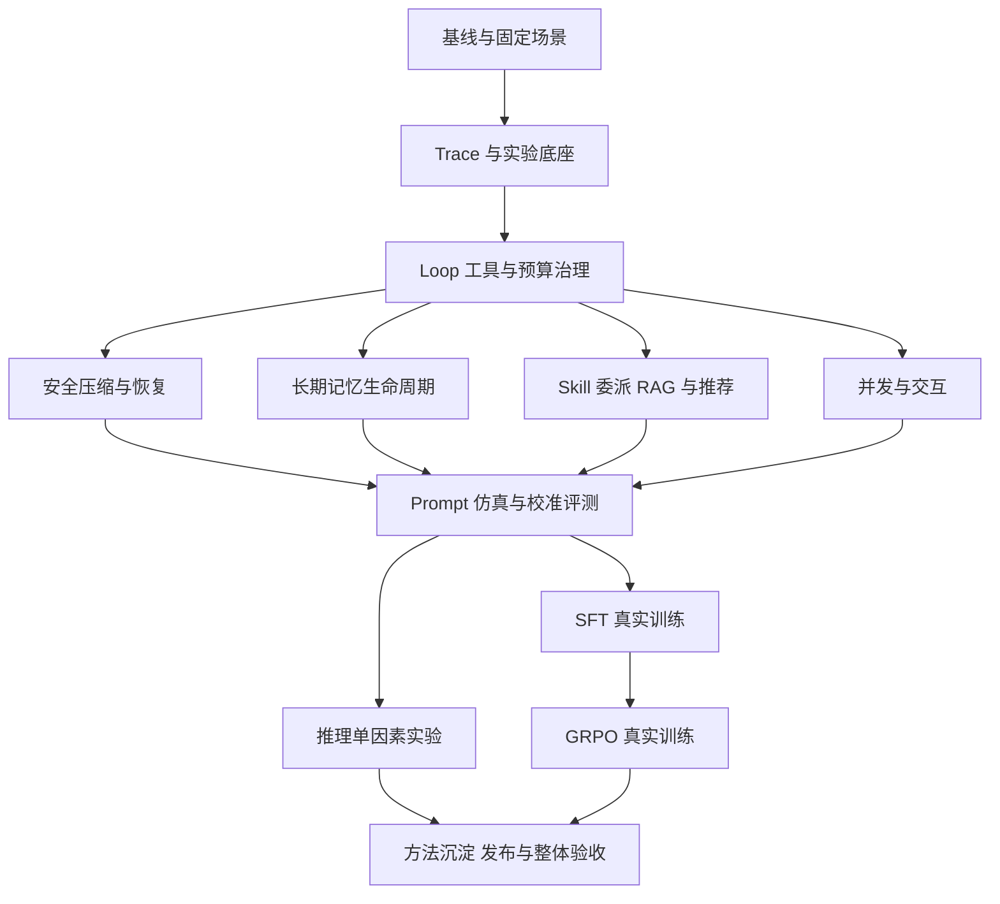

# 个人推荐 Agent 能力完善实施计划

日期：2026-10-18。状态：**P0.2–P0.4 本地基线与验收已提交；P0.1 远程连接超时；P1 已接通生成调用观测、平台与评测账本、有界平台及 OTLP 元数据导出，其他范围仍在实施清单中**。详见 [基线报告](../../reports/agent-capability-baseline-20261018/README.md)、[P1 首批报告](../../reports/agent-model-observation-20261018/README.md) 与 [平台计量及 OTLP 报告](../../reports/agent-otlp-and-usage-20261018/README.md)。

本轮授权：将已整理的、适用于个人推荐 Agent 的能力完整落实到项目；先保存并 push 当前代码，再形成计划，随后分阶段实施。AgentTeam 实习项目不在本次范围。

## 1. 开发基线与执行约定

- 已保存基线：[`c5d5b597cff8e88e093453954469a991c853207f`](https://github.com/sinrotic/RS_agent/commit/c5d5b597cff8e88e093453954469a991c853207f)，已 push 到 `origin/main`。这是现有工作区快照，不等于全量测试通过的发布版本。
- 后续分支：`feat/agent-capability-completion-20261018`。每阶段单独提交实现与验证记录，不混入 AgentTeam、交易系统扩建或简历排版。
- 原始大文件 `profiled-spans.json` 保留本地，仓库保存无损 gzip 与哈希校验说明；过程状态、密钥、模型权重和数据库目录继续按忽略规则管理。
- 默认产品主线是 Java；Python 承担推荐算法、数据、仿真、评测、训练及模型运行适配。不能把两套运行时的局部实现当作已经接通的产品功能。
- 本地内存目标 12GB、上限 14GB。训练、全量数据处理和重模型加载按资源门禁转为限流 smoke 或独立远程任务；不为跑测试加载正式模型。
- 阅读依据：[源码审计](../../research/2026-10-18-agent-capability-audit.md)、[官方机制核验](../../research/2026-10-18-agent-official-mechanisms.md)。这些是决策输入，功能完成以本计划的运行验收为准。

**本计划的“全部”**：下面覆盖表内所有适用能力均需有实现、调用接入及验收，不只补类名、配置、文档或 mock。外部资源或人工标注未具备时，记录尚未完成的具体步骤，不将 dry-run、初始化成功或代理分当作验收完成。

## 2. 产品目标与不变量

围绕“需求理解 → 推荐执行 → 反馈修正”建立完整个人项目：既能展示推荐系统基础，也能解释 Agent 架构、优化过程、并发服务、评测与后训练。

继承现有架构约束：

1. `rs-service-agent` 组织 Session、Turn、模型循环、工具、SSE 和 Effective Context；`rs-service-recommend` 封装召回、排序、反馈与商品检索，`Catalog` 保持商品事实所有权。
2. Durable Session History 与 Context Checkpoint 以 ScyllaDB 为权威，MySQL 保存可修复定位／管理投影，Redis 保存可重建热状态，遵循 [ADR-0001](../../adr/0001-session-history-and-checkpoint-authority.md)。
3. 压缩只在 Safe Compaction Boundary 生效，不能拆 TOOL_USE／TOOL_RESULT，不能删除持久历史，遵循 [ADR-0003](../../adr/0003-compaction-only-at-safe-model-call-boundaries.md) 和 [ADR-0004](../../adr/0004-auditable-lossy-context-truncation.md)。
4. Context Checkpoint 不固化系统提示词、工具 Schema 和动态规则，遵循 [ADR-0002](../../adr/0002-context-checkpoint-excludes-runtime-injection.md)。实验版本元数据不能绕过当前权限、工具撤销与配置校验。
5. 本计划不向 Agent 接入不可逆的下单、支付、发消息等工具，遵循 [ADR-0005](../../adr/0005-first-release-tools-must-be-replay-safe.md)。记忆管理通过用户明确操作和可安全重试的内部命令实现，独立检查身份、版本和幂等。
6. 同一 Session 由 Session Execution Lane 串行处理 Turn，跨 Session 并发；本轮保持单个活跃 Agent 实例，遵循 [ADR-0007](../../adr/0007-first-release-uses-one-active-agent-instance.md)。不能仅加 Redis 锁就宣称 Agent 已支持多活。
7. Recommendation Feedback Event、Preference Version 与在线投影遵循 [ADR-0017](../../adr/0017-feedback-event-authority-and-online-preference-projection.md)，保留“已持久化”和“已生效”的区别。
8. 当前明确要求优先于历史弱偏好；Account、Profile User、Session 的范围和归属按 [CONTEXT](../../../CONTEXT.md) 使用，不能由模型任意填写身份。

**需要先明确的设计增量：**当前领域词汇中的 RAG Evidence 侧重既有候选的解释。查询规划检索应独立定义其输入输出，不能悄悄把解释证据变成 Recall Source。Prompt 版本绑定、记忆事实权威与策略发布也是新增决策；实施相应阶段前补充 ADR／领域说明，存在冲突时先明确修订，不直接覆盖旧决策。

## 3. 能力覆盖与交付映射

| 编号 | 适用能力 | 主要实现位置 | 必须交付 |
| --- | --- | --- | --- |
| C01 | 显式 ReAct Loop、阶段与终止、任务状态 | Java Agent Loop／Capability | 真实调用链与每种终态，不只演示成功回复 |
| C02 | Skill 目录、按需加载、资源分层、版本撤销 | Java Runtime Configuration／Skill 工具 | 选择、加载、使用、撤销的端到端证据 |
| C03 | 按需委派与独立上下文、结果证据汇总 | 现有 Delegate 接口与 Java 编排 | 短查询直接处理、长探索委派的取舍对照 |
| C04 | 热门、协同过滤、三塔等召回与精粗排、反馈重排 | Java Recommend＋现有 Python 产物 | 当前实际路由审计、固定候选预算的质量对照 |
| C05 | RAG 混合检索支撑查询生成及辅助解释 | Recommend 语义接口、既有 Python RAG | 原查询／模型改写／RAG 辅助改写消融 |
| C06 | 结果外置、回查、边界压缩、缓存友好输入 | Java Context／Checkpoint／ToolResult | 自动触发、配对保护、恢复及成本对照 |
| C07 | 用户长期记忆提取、检索、修改、撤回、失效 | Java Memory＋既有 Python 算法 | 跨 Session 生效、范围与版本一致性、缓存失效 |
| C08 | Hook、错误分类、循环检测、漂移检查 | 现有 Hook Dispatcher | 策略真实生效，误拦与检查成本报告 |
| C09 | 工具超时、分类重试、熔断、半开恢复 | Java Tool／Model 执行路径 | 故障注入、探测竞争与取消释放测试 |
| C10 | Turn 总期限、token／费用账本、模型路由降级 | Java Loop／Model Wrapper | 并发预留、实际结算、完整 usage 与完成范围 |
| C11 | 并发准入、容量排队、公平性、SSE、取消与恢复 | Agent、Gateway、React | 排队／执行／终态区分，断线不重跑 Turn |
| C12 | 约束解码、Schema、业务正确与执行授权 | Model Stream／Capability | 格式、业务、授权分层检查与开关实验 |
| C13 | 外部内容来源约束、工具与输出护栏 | 输入组装、工具执行、公开输出投影 | 攻击与正常样例回归，流式输出检查 |
| C14 | Trace、阶段耗时／token 归因、Langfuse 适配 | 现有 Trace＋OpenTelemetry 导出 | 主子调用关联、缺失显式、计量不重复 |
| C15 | 部分量化、前缀缓存、BGE FP16 批推理、预热 | 现有模型服务与部署脚本 | 各优化单独测量、混合负载与质量回归 |
| C16 | 固定多轮仿真、Rubric、规则与 LLM Judge | Python Simulation／Online Evaluation | 冻结数据、人工校准入口、分项与分歧结果 |
| C17 | Prompt 不可变版本、对照实验、会话版本选择 | Java Runtime＋Python 实验 | 版本／工具契约／数据／评分可追溯 |
| C18 | 真实 QLoRA SFT、助手监督、导出与重载 | Python Offline Training | 实际更新、标签检查、模型产物、独立评测 |
| C19 | 真实 GRPO、工具环境 rollout、奖励诊断 | Python Offline Training／Simulation | 当前策略组采样、训练更新、留出效果与投机检查 |
| C20 | badcase 回归、策略候选、方法库与采用验证 | Python 评测／策略、Java 只读消费 | 保存／展示／采用／效果分别记录 |
| C21 | 版本晋级、回滚／撤销、停止接单、退出与恢复 | 部署、Runtime、管理端 | 故障与更新演练；新旧版本兼容与回滚记录 |
| C22 | 文档、可复现实验与面试材料 | 知识库、ADR、报告 | 每个重点有证据、取舍、反例、指标口径 |

不为了套用教程新增购物交易业务、AgentTeam 角色体系或任意代码执行 Sandbox。部署侧交付生命周期适配与可验证配置；没有目标集群时不把 YAML 存在当作 K8s 部署验收。

## 4. 已有基础与实际缺口

| 主题 | 本轮已确认的基础 | 需要补齐 |
| --- | --- | --- |
| Runtime／工具 | `AgentLoop`、Hook 事件、Capability 授权、虚拟线程、准入与取消 | 默认放行的 Hook 策略、分类恢复、无进展与依赖熔断 |
| RAG／Skill | Python 混合检索与查询规划入口；Java 有 `load_skill`／结果读回 | Java 产品调用接通、版本与撤销、独立效果证据 |
| Context | 大结果外置、手动归档、读取恢复算法及相关 ADR | 自动安全触发、完整工具组、摘要／检查点生产与恢复闭环 |
| Memory | Python hydrate／提取／相关召回；Java 索引与正文适配器 | 明确权威和产品路径、修改撤回失效、CAS、有效记忆注入 |
| Trace／Judge | 自研 HTTP Trace；模型 Judge 接口和规则质量筛选 | 完整关联、Langfuse Adapter、人工校准与可信评分范围 |
| 推理 | 部分量化、vLLM 前缀缓存、BGE 批推理配置与原基准 | 当前版本重核、单因素实验、长短混合负载与尾延迟 |
| 训练 | 数据／奖励／资源门禁／模型与 LoRA 初始化 | 构造 Trainer、真实训练、assistant mask、rollout 与产物验收 |

三塔已有产物、数据与 [实验计划](2026-09-14-three-tower-experiment-plan.md) 应先复用并核对当前 Route Gate，不重复启动一套数据工程，也不把产物文件存在当作主路已晋级。

## 5. 模块与 Interface 设计原则

复用已有 Module 与真实 Seam；策略集中在少数可测试 Interface 后面，不在 Controller、前端和多个工具中复制相同规则。以下是行为契约草案，名称可随已有类型调整：

| Module | 调用方需要知道的 Interface | Implementation 应封装的复杂性 |
| --- | --- | --- |
| 执行治理 | 当前 Turn、工具调用、期限、取消信号 → 允许／拒绝／执行结果及原因 | 超时、幂等前提、依赖故障、熔断、许可释放；不要求调用方手工排列多个策略 |
| 上下文治理 | 当前持久事件点位、Effective Context 与容量 → 本次模型可见输入或明确失败 | 配对分组、保护、外置、摘要、检查点提交和失败保留 |
| 长期记忆 | 可信主体＋操作 ID＋expected version＋明确事实 → 已提交版本或冲突；读取返回有效相关项 | 正文、索引、状态、投影补偿、撤回、缓存标识；不能只暴露多个数据库的 save 方法 |
| 观测导出 | 一次真实调用／状态变化 → 非阻塞记录结果 | Trace 关联、脱敏、批送、flush、丢失计数、平台差异；观测失败不授权业务动作 |
| 评测执行 | 冻结场景＋被测版本＋数据快照 → 原始轨迹、分项和汇总 | 环境重置、运行隔离、规则校验、Judge、完整成本与归因 |
| 训练执行 | 数据 manifest＋模型／模板版本＋资源配置 → 可加载产物与报告，或明确资源失败 | 数据校验、监督 mask、Trainer、检查点、随机状态、评测和输出登记 |

优先通过调用方同样使用的 Interface 做行为测试。Clock、模型客户端、工具下游、存储和观测导出可注入 Adapter；有内存与真实存储等实际变体时复用已有 Seam，避免只为假设的未来需求再造通用框架。

## 6. 分阶段工作清单

### P0：冻结范围、运行基线与验收场景

- [ ] P0.1 核对当前启用的配置、模型、召回排序 Route、Skill 与 Java/Python 调用关系，产出能力清单及版本 manifest。（已完成仓库配置/预设/历史报告区分、文件指纹与六项 Skill 清单；远程实际运行配置仍待核验。）
- [x] P0.2 运行现有 CI 对应的轻量门禁，记录已有失败；基线快照不能冒充已通过版本。（Java/Python/前端/浏览器/部署契约已执行，36 条历史规范问题逐条记录。）
- [x] P0.3 建立固定多轮场景、商品快照与可信身份测试数据，场景版本和 train/dev/test 拆分规则入库。（合成目录和身份，仅工程验收；不作为训练泛化独立证据。）
- [x] P0.4 定义终态、完成条件、硬约束、unknown、指标分母及缺失 usage 的统一口径。（计算契约和测试已交付；生产完整事件接入按 P1 实施。）

**主要入口：**现有 `python_agent/benchmarks/skill_benchmark/`、`rs_core/online_evaluation/`、Java Agent/Recommend 测试、现有部署与模型报告。

**完成条件：**从浏览器或 Java API 走完推荐和一次反馈，能用同一数据重跑；基线报告列出真实配置与失败，不在此阶段调参追求数字。

### P1：观测与实验底座（C14、C16、C22）

- [ ] P1.1 规范 `session_id/turn_id/run_id/tool_call_id` 与父子任务、模型／Prompt／Skill／数据版本字段，复用现有 Trace 事件。（已接入生成尝试独立 ID、Turn/Loop 关联，以及请求组装处 Prompt/工具/Skill/选项/Adapter 指纹；Java 主线真实 HTTP 校验通过，评测保留逐次摘要与字段覆盖率。范围与未知项见 [请求指纹报告](../../reports/agent-request-fingerprints-20261018/README.md)；跨 HTTP 委派、完整数据/权重来源和不可变配置资产仍待补。）
- [ ] P1.2 在真实模型请求处记录普通生成、摘要、Judge、失败重试的 usage；按服务支持字段拆输入、输出、缓存读写，未知保持未知。（普通生成及失败/取消快照已接通，其他种类待补；提前停止不假设用量已完整。）
- [ ] P1.3 提供 Langfuse／OTLP Adapter，并保留现有平台观察能力；可配置关闭、受控脱敏、异步队列有界、退出 flush 和丢失可观察。（已完成双目标独立开关/队列、外发白名单/HMAC、OTLP JSON 与 Langfuse 适配、部分拒绝处理及本地 HTTP 验收；平台已改为最终调用账本和时间区间并集。真实目标验收、指标注册与重放待补。）
- [ ] P1.4 固定评测运行器输出逐条轨迹、规则结果、Judge 原因与完整资源账本，失败样例可从报告定位到调用。（Skill Benchmark 已接入生成调用账本及最终/缺失覆盖率，受控 Java HTTP 联调通过；仍非全系统资源账本。）

**主要入口：**`HttpAgentTraceReporter`、`TraceReportingAgentCapabilityAuditSink`、`InMemoryAgentOrchestrationService`、`rs-service-platform-trace`、`online_evaluation/evaluator.py`。

**验收：**一次跨线程、跨 HTTP 的推荐能关联；工具失败／取消／摘要链路都出现；并行 Span 不重复计总耗时，重复导出不重复记模型消耗，导出故障可见且不拖死业务。

### P2：Loop、工具与预算治理（C01、C08—C10、C12—C13）

- [ ] P2.1 在现有 Loop 和 Hook 上统一执行前检查、执行结果检查与终止原因；区分必要授权失败和可选观测失败。
- [ ] P2.2 实现按 Turn 隔离的无进展检测，结合工具、规范化参数与结果特征；合理翻页、预算变更、结果刷新不误判为循环。
- [ ] P2.3 工具失败按参数、业务无结果、授权、超时、暂时依赖故障和取消分类；重试受可安全重放条件、次数和总期限限制。
- [ ] P2.4 在真实依赖 Seam 加熔断与受控半开探测，验证旧周期迟到结果、取消与失败后的恢复；不将业务拒绝计为基础设施故障。
- [ ] P2.5 建立 Turn 共享 token／费用账本：调用前原子预留，返回后实际结算，重试／摘要／Worker 同账；缺 usage 的保守预算与实际账单分开。
- [ ] P2.6 根据可用预算选择已验证的模型档位、简洁模式或已有证据收尾；检查备用模型窗口，不能靠降级跳过授权与事实核验。
- [ ] P2.7 校验输出 Schema、商品存在与证据归属、硬约束和执行权限；约束解码只负责形式，语义与业务规则继续校验。
- [ ] P2.8 将外部商品／检索／Skill 正文按来源作为数据处理；拒绝扩权，流式公开输出经既有投影和必要的连续片段检查，保留攻击与正常案例。

**主要入口：**`AgentLoop`、`GlobalAgentLoopHookDispatcher`、`AgentCapabilityToolUseExecutor`、`VirtualThreadAgentToolUseExecutor`、`AgentExecutionLimiter`、`SpringAiAgentModelStreamClient`、`PublicAgentStreamProjector`。

**验收：**必要校验异常不放行；故障、空结果和 unknown 不混淆；同一 Turn 的并发调用不能重复占用预算；停止条件落实到执行分支，取消后许可和连接能释放。

**漂移检查约定：**先落地规则信号与离线语义检查，测误报、漏报和额外成本；需要时配置疑点复核与定期抽查。`not_reviewed` 不算通过，用户主动换需求不算漂移，停止探索必须有执行层控制。

### P3：自动安全压缩、缓存与恢复（C06）

- [ ] P3.1 以 Session Event 建完整工具语义组和未完成调用集合，只有 Safe Compaction Boundary 可提交新的 Effective Context。
- [ ] P3.2 优化工具结果视图与分页，完整结果先外置；模型尚未读取和当前受保护字段不能直接有损抹除。
- [ ] P3.3 实现自动容量检查、旧结果治理和结构化摘要，保护最新约束、当前候选、近期原文与未完成动作；摘要失败保留上个有效状态及新增原文。
- [ ] P3.4 写入权威 Context Checkpoint 后切换热状态；验证权威失败、投影失败、Redis 丢失、检查点缺失／损坏的不同处理。
- [ ] P3.5 按 ADR 重建模型输入：系统／工具配置重新注入，固定序列化与顺序，动态信息更新；不照搬其他模型平台的显式缓存断点。
- [ ] P3.6 完成不压缩、仅外置、外置＋摘要、缓存开关的对照，记录约束保留、回查、总输入、摘要／重试成本及 TTFT。

**主要入口：**`AgentEffectiveContextService`、`DefaultAgentSessionCompactionService`、`DefaultAgentSessionJournal`、`AgentTranscriptCheckpointStore`、`DefaultAgentTranscriptRecoveryService`、`AgentToolResultExternalizer`。

**验收：**长对话实际触发自动压缩；调用配对完整；最新预算、否定约束和选中商品正确延续；冷恢复与压缩前语义一致；故障不能静默创建空历史。

### P4：长期记忆产品链路（C07）

- [ ] P4.1 明确 Account／Profile User／Session 归属、长期记忆与 Session/Profile Preference 的区别；确定正文权威、索引可修复性和版本 CAS，先写 ADR。
- [ ] P4.2 从明确保存意图／用户操作提取有原文依据的事实，保留范围与否定；区分候选、有效、撤回／失效，不凭模型自信扩大长期偏好。
- [ ] P4.3 接通 Java 主线提取、相关检索与注入；复用 Python 已有算法，必要时迁移小型逻辑或通过既有受控接口调用，避免维护两个权威记忆源。
- [ ] P4.4 实现新增、查看、修改、删除／撤回和失效，以及稳定 ID、expected version、操作幂等与并发冲突返回；正文与索引失败有可重试补偿。
- [ ] P4.5 每轮只注入当前有效相关项；处理本轮要求优先、送礼对象隔离、负向约束与检索降级，允许 unknown。
- [ ] P4.6 将偏好／记忆版本纳入真正复用答案或推荐结果的缓存范围；删除后索引、热状态、摘要和旧缓存不能把记忆恢复为当前要求。
- [ ] P4.7 在现有 React 交互中补必要的查看、修改、撤回及冲突反馈，不把底层存储细节暴露给产品用户。

**主要入口：**`AgentMemoryItemStore`、`AgentMemoryIndexStore`、`ScyllaAgentMemoryItemStore`、`MysqlAgentMemoryIndexStore`、`AgentSessionMemoryCapability`、Python `agent/memory/`、现有反馈和前端偏好入口。

**验收：**新 Session 正确使用有效偏好；临时预算不误记；跨用户不串读；同一旧版本修改冲突；撤回后后续推荐和恢复均不再沿用。历史原文与当前有效记忆不混同。

### P5：Skill、委派、RAG 与推荐深度（C02—C05）

- [ ] P5.1 核对当前三塔、协同过滤、热门及精粗排真实启用路线；复用既有产物与实验，补固定候选预算及 User／Query 贡献对照。
- [ ] P5.2 通过 Recommend 语义 Interface 接入查询规划知识检索，保留混合检索、来源、分块与配置版本；查询规划和候选解释分别记录。
- [ ] P5.3 比较原查询、纯模型改写和 RAG 辅助改写，观察否定／预算／用途保留与候选质量；解释另测证据忠实度，不能仅按检索相似度宣称推荐更好。
- [ ] P5.4 Skill 按目录、正文、相关资源渐进加载，版本／哈希／主体校验、更新撤销和压缩保护接通；常用领域方法不全量常驻。
- [ ] P5.5 复用 Delegate 实现自包含子任务、独立上下文、共享预算／准入与证据化返回；简单工具调用不必强制派发。
- [ ] P5.6 主 Agent 校验 Worker 的结论、候选 ID 与证据，保留部分成功和缺口；用真实起止时间验证并发，不把多路耗时相加当总耗时。

**验收：**推荐主链实际消费新能力；索引故障、无知识、候选无结果分别可解释；候选与知识数据固定；Skill 已加载不扩大工具权限；委派收益同时看质量、延迟和总调用量。

### P6：并发服务与交互完成度（C11、C21 部分）

- [ ] P6.1 在既有 active-loop／model／tool／recommend 准入上明确等待上限、有界容量、繁忙响应及排队状态；同 Session 保持串行，跨 Session 隔离。
- [ ] P6.2 为长短任务混合负载验证公平性和饥饿问题；只有当前名额策略不足时增加独立队列，先按差额控制在飞数，不直接替换信号量。
- [ ] P6.3 SSE 事件关联 Turn 与持久终态，展示排队、模型、工具、部分结果和完成状态；代理缓冲、心跳、重连游标与重复订阅有端到端验证。
- [ ] P6.4 区分断线订阅与重发用户消息，同一次发送重试保持 turn_id；停止／总超时传播至底层，迟到结果不能把终态改回运行中。
- [ ] P6.5 测停止接单、在飞收尾、超时取消、flush 和冷恢复，整个关闭过程共用期限。

**验收：**在固定并发、输入长度和超时口径下，记录成功、拒绝、排队、取消和失败；不能只挑成功请求算延迟；实例替换后恢复已提交事实，不虚构恢复模型执行栈。

### P7：Prompt 版本、仿真与可信评测（C16—C17）

- [ ] P7.1 将 Prompt 与依赖工具契约、Skill／模型配置生成不可变实验版本，保存改动原因、案例和评价规则。
- [ ] P7.2 会话只保存版本选择元数据；运行时解析允许版本并复核当前工具／权限，撤销优先；涉及 ADR-0002 的行为增量先明确决策。
- [ ] P7.3 对固定多轮场景重置历史、记忆、反馈和工具环境，覆盖澄清、需求改变、缺信息、故障、长对话与正常结束。
- [ ] P7.4 确定性硬条件单列；Rubric 按推荐相关性、偏好满足、解释忠实度及交互质量拆分，语义不足允许无法判断。
- [ ] P7.5 提供人工标注／复核入口和独立校准集，比较 Judge 的逐维一致性、位置偏差、误判与缺证据；无人工记录时保持 `uncalibrated_proxy`。
- [ ] P7.6 Prompt 开发集对照与最终留出测试分开；按任务／会话／用户或意图组切分，检查改写与近重复泄漏。
- [ ] P7.7 先固定不训练的最佳可解释提示词基线，再进入 SFT；总体均分之外保留各类退化、硬约束失败和完整开销。

**验收：**同条件复现新旧差异；评分证据可查；规则用户的 satisfaction 与 Judge 分、真实用户反馈分开命名。不能人为填写校准通过或满意度提升。

### P8：推理部署的单因素实验（C15）

- [ ] P8.1 固定模型权重、模板、解析器、vLLM／BGE 运行版本和设备，核验当前正式配置；已有失败方案不重新写成有效优化。
- [ ] P8.2 比较 BF16 与既有模型部分量化，先查业务、格式与推荐质量，再比较显存和延迟。
- [ ] P8.3 前缀缓存与预热单独开关，冷／热请求分列，测 TTFT、TPOT、输入输出及缓存用量；静态前缀变化有解释。
- [ ] P8.4 BGE FP16 与候选批量分别比较，验证长文本、OOM 回退、索引／分数对齐及和 LLM 同 GPU 的混合负载；不把批推理写成跨请求动态合批。
- [ ] P8.5 调整并发／序列容量时同时记录成功率、拒绝、尾延迟、吞吐与显存；预热覆盖工具调用、代表性长输入和取消。

**验收：**先保持正确性，再报告各自收益与组合收益；测量材料可复跑，正式服务切换前可回滚，不覆盖原报告。

### P9：SFT 真正贯通（C18）

- [ ] P9.1 把已有合成／仿真／审核轨迹接成版本化 JSONL／manifest，保留当时工具定义、调用配对与来源；高分还需事实与质量筛选。
- [ ] P9.2 用 Qwen3.5-4B 实际聊天模板编码，检查助手调用及回复参与 loss，系统／用户／工具返回和 padding 不参与；工具返回仍是可见输入。
- [ ] P9.3 补齐 `sft_runner.py` 的真实 Dataset、Trainer 构建、训练、日志、保存、恢复与导出，dry-run／init-only／train 模式严格区分。
- [ ] P9.4 先做资源可控的真实更新 smoke，确认可训练参数发生变化、产物可重载，并记录基座／模板／数据／依赖版本；随后扩至经过门禁的数据规模。
- [ ] P9.5 对 Prompt 基线与 SFT 使用相同留出场景和服务环境，检查满意度相关分项、硬条件、工具选择、成本与退化；格式开关独立消融。

**主要入口：**`offline/training/sft_runner.py`、`qwen_loader.py`、`data_contracts.py`、`sft_judge.py`、已有多轮样本生成器、资源门禁。

**验收：**必须有真实优化器更新、保存重载和独立任务结果；训练 loss 下降、import Trainer 或加载 LoRA 不算完成。正式 GPU 训练不在本机突破 14GB 上限。

### P10：GRPO 与环境训练（C19）

- [ ] P10.1 建立受控工具环境，固定场景、数据和初始状态；只读回放按规范化参数及快照命中，未覆盖单独统计，不伪装成空候选。
- [ ] P10.2 同一任务由当前 policy 生成多条完整轨迹，记录实际生成 token 与工具观察，不能用旧高分轨迹重放代替当前策略采样。
- [ ] P10.3 奖励以推荐相关性、偏好满足与解释忠实度为主，硬条件违规独立门禁，交互／成本为受限辅助项；自称满足条件不能得分。
- [ ] P10.4 补齐 `grpo_runner.py` 与实际 TRL 版本适配、组采样、生成 mask、奖励、训练、保存恢复；GRPO 和教程 GSPO 的公式／参数不混用。
- [ ] P10.5 先真实更新 smoke，再按资源预算扩展，记录组内奖励方差、长度、截断、更新幅度／可选 KL 与环境错误。
- [ ] P10.6 在留出集比较 Prompt、SFT、SFT＋GRPO，检查空回复、凑关键词、减少推荐数量等投机；训练奖励上涨但业务退化时不晋级。

**主要入口：**`offline/training/grpo_runner.py`、`reward_adapter.py`、现有 simulation／policy、模型客户端与资源门禁。

**验收：**当前策略真实 rollout、参数实际更新、产物可重载、独立比较完整；没有收益的实验同样留存，不预设训练一定提高指标。

### P11：经验沉淀、版本晋级与整体验收（C20—C22）

- [ ] P11.1 每条 badcase 关联最小复现、最早偏离阶段、候选修复、反例与回归；模型诊断标为假设，不直接记为根因。
- [ ] P11.2 提炼有范围、例外、证据、版本、有效期的推荐策略候选；与用户私有记忆分开保存。自动提案不自动发布。
- [ ] P11.3 已验证策略只读接入 Skill／知识检索；分别记录正文展示、实际采用和对照效果，未命中不能归因策略收益。
- [ ] P11.4 Prompt／Skill／模型／策略发布与内容版本分开，补小范围版本选择、回滚与撤销，现有 Session 的兼容行为明确。
- [ ] P11.5 完善 Compose 健康、就绪、预热、drain、持久数据恢复与 SSE 代理配置；目标环境需要 K8s 时提供等价验证配置，单活 Agent 不以多副本滚动更新冒充水平扩展。
- [ ] P11.6 全链路正常、故障、长历史、并发、恢复及训练产物验收；同步知识库与实际依赖版本，形成可复现 demo、架构说明和实验索引。

**完成条件：**C01—C22 均有具体实现入口、产品或实验调用证据、验证报告及限制；真实标注、GPU 训练、远程部署未完成项不能由代码覆盖率或配置检查代替。

## 7. 依赖与执行顺序

图表示工作依赖，不表示已安排多 Agent 并行开发。小型接口和标签核验可提前，正式效果比较必须等场景、数据和目标实现稳定。先逐阶段形成可运行增量，不在同一提交里同时改模型、Prompt、召回和评分以致无法归因。

## 8. 固定验收场景

| 场景 | 必须观察的行为 | 主要覆盖 |
| --- | --- | --- |
| 清晰的短推荐需求 | 直接使用合适工具，事实与解释对应，不无意义委派 | C01、C03—C05 |
| 模糊用途与必要信息缺失 | 适当澄清或带 unknown 提供参考，不编造硬条件 | C01、C12、C16 |
| 多轮提高预算／新增材质排除 | 最新要求进入查询和重排，旧要求不继续覆盖 | C04—C07 |
| 为他人选礼物 | 当前收礼人需求与用户历史区分 | C07、C16 |
| 大工具结果和长对话 | 外置与自动压缩真实触发，调用配对和关键约束保留 | C06 |
| 压缩后重启／Redis 丢失 | 从权威历史和检查点恢复，不用过期注入；失败明确 | C06、C21 |
| 保存偏好后新 Session、修改与撤回 | 生效、冲突和删除结果可观察，旧缓存不继续沿用 | C07 |
| 两个用户与多个 Session 并发 | 身份、记忆、反馈、工具结果和 Trace 不混串 | C07、C11、C14 |
| 模型／精排持续故障 | 分类错误、有限重试、熔断与恢复，不当成无商品 | C08—C10 |
| 长短请求高峰与取消 | 队列有界、无长期饥饿、许可释放、状态终结 | C11 |
| 流式断线、重复订阅、发送重试 | 续读已产生内容，原 turn_id 防重复执行 | C11 |
| 工具结果夹带扩权文字／Skill 已撤销 | 外部数据不变授权，当前权限与版本撤销生效 | C02、C12—C13 |
| Prompt 修改、模型替换、策略注入 | 固定条件对照，硬约束和失败分项保留 | C16—C17、C20 |
| SFT／GRPO 导出并接回模型服务 | 权重／适配器真实可用，格式、推荐与性能重验 | C15、C18—C19 |

每个实验记录任务种类和独立场景数；同一场景重复运行用于估计波动，不能算作新增独立任务。训练与评价工具环境重置，避免用户记忆或前次结果污染。

## 9. 检查、资源与报告规范

### 开发检查

- Java 聚焦修改模块运行 `mvn -B -f java_agent/pom.xml -pl rs-service-agent -am test` 等相应门禁；跨模块契约或完成阶段再跑父 POM 全量测试。
- Java 前端按现有脚本执行 type-check、Vitest、build；交互变更运行实际浏览器流程。
- Python 使用工程契约检查与 marker 选择器执行对应 unit／smoke／serving 测试；新增训练测试默认用小型依赖 Adapter，不在单元测试加载大模型。
- 部署、真实数据库与 GPU 测试单列，在目标环境使用冻结配置。修改后只运行相关检查，已通过且未再变化的检查不重复扩跑。

### 资源与训练

- 先只读核对远端可用 GPU、服务占用、存储和已有资产，再选独立任务目录及资源门禁；不抢占现有推理服务或覆盖正式模型。
- 训练／评测锁定模型、模板、依赖、样本与随机状态；真实更新 smoke 后再扩大长度、批量和并发。
- 产物存受控 Artifact 目录，Git 保存代码、manifest、哈希和必要报告；不 push 私有原始对话、凭据、完整权重或大规模数据库副本。
- 人工语义标签和 Judge 校准需要真实复核；缺失时交付待复核队列及可运行流程，保持未校准状态，不填造人工结果。

### 每阶段报告

在 `docs/reports/agent-capability-completion-20261018/` 建阶段索引，至少记录：基线与候选 commit、配置、数据／模型／Prompt／Skill 版本、命令、任务及样本规模、资源、逐条结果、失败、成本、对照、限制与回滚。代码实现、运行通过、效果验证、正式启用分别登记，不用一个“完成”混写。

## 10. 指标沿用与新结果的关系

| 原简历指标 | 本计划的处理 |
| --- | --- |
| 输入 token 降低 32% | 保留原记录，补场景与完整调用成本；新压缩实现需要重新测量 |
| 约束解码格式遵循提升约 23.1% | 单独对照解析／Schema 合规，明确相对变化或百分点，不算训练满意度收益 |
| 仿真满意度提升 23% | 追溯原评分与产物，不能归因于目前只初始化的训练入口；新实验按固定规则重测 |
| 首 token 均值 165ms | 补测量边界、并发、输入与缓存条件；不作为所有请求的保证 |
| 完整推荐 3.37s → 2.35s，约 30% | 保留原组合基准；新单因素实验不预分配各开关贡献 |

本计划不以达到既定宣传数字作为验收条件。若训练或治理未改善效果，记录失败、定位原因和可用基线，不能通过改评分、移除失败样本或更换分母使结果通过。

## 11. 阶段退出与最终交付

每阶段按照“实现 → 真实接入 → 对应验证 → 更新证据 → 提交”推进。需要数据库迁移、模型切换或重负载实验时，先准备可审查配置和回滚材料，再按当前授权与实际环境执行。

最终交付包含：

1. Java 产品主链上的推荐 Agent 完整能力，Python 评测与训练通过明确契约服务它。
2. C01—C22 的实现、测试与实际运行索引，保留未完成和不适用的原因。
3. 可运行 demo，覆盖多轮推荐、即时反馈、长对话、跨会话记忆、失败恢复与并发服务。
4. Prompt／Context／Memory／RAG／推理优化的对照报告，以及 SFT／GRPO 的真实训练产物与留出评测。
5. 架构决策、方法与反例目录、故障案例和每个简历重点的证据卡片。简历只引用已经验证的结论。

**下一项执行工作：P0.1—P0.4。** 先取得当前实际主链基线，再按依赖开始开发；AgentTeam 暂不处理。
